# Spork

Spork tracks allergen cross-contact in a restaurant kitchen. An overhead camera follows every bin, utensil, hand and plate. Each contact between them is logged as a time-stamped edge in a graph. When a plate reaches the pass, Spork checks which allergens could have reached it and holds the plate if its ticket forbids any of them.

Built at CalHacks, October 23–25, 2026, by Shashank Lahoti and Gaurav Bansal.

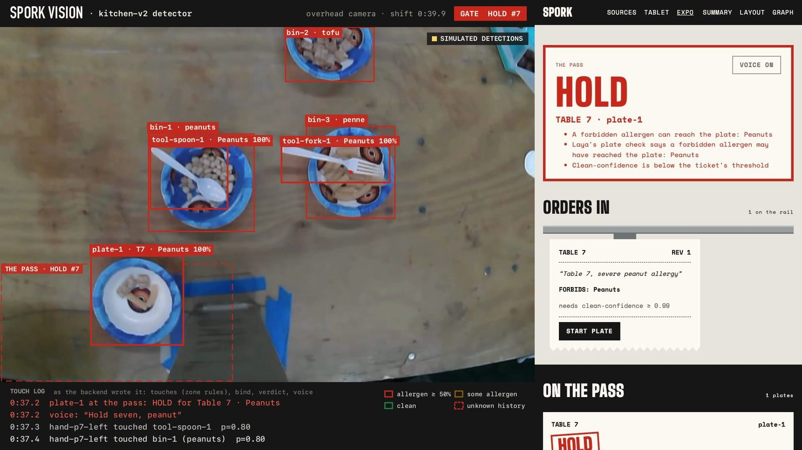
<sub>The expo screen. Left: the overhead camera, with each entity's ID and the allergens it carries. Right: table 7's plate is held, with the three reasons. Frames where some boxes were filled in by hand are tagged "simulated detections" (top right).</sub>

## Why

Writing "peanut allergy" on a ticket doesn't tell the kitchen which knife went into the satay before it touched the salad. For someone with a severe allergy, the question is whether anything that touched peanut touched their dish. Spork records every contact so that question has an answer.

A wrong PASS can hurt someone. A wrong HOLD costs a minute. So every unclear case defaults to HOLD.

## How it works

1. The server types the ticket, for example "Table 7, severe peanut allergy". A fine-tuned Laya model turns it into forbidden allergens and a severity. Fields it isn't sure about become one-tap questions, and the ticket can't be sent until they're answered.
2. The kitchen's zones (bin slots, wash, plating spot, clean stack, pass) are drawn once over the camera feed.
3. A YOLO detector and a pose model find bowls, utensils and hands in each frame. A tracker gives each object a stable ID and records where it was first seen.
4. When two objects come close, the contact is classified as a scoop, contact, wipe or wash, and written to SpacetimeDB as an edge.
5. The graph moves allergen probabilities along the edges in time order. A wash resets a tool.
6. When a plate reaches the pass, plain code compares the allergens that could have reached it with the ticket and returns PASS or HOLD. The gate opens only on PASS, and each hold is announced ("Hold seven").
7. Amending a ticket re-checks the plate against its full history.

<table>
<tr>
<td width="50%">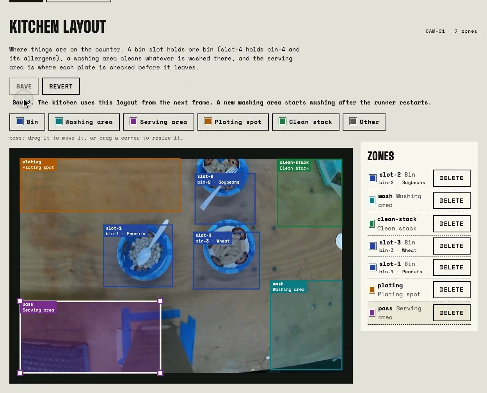</td>
<td width="50%">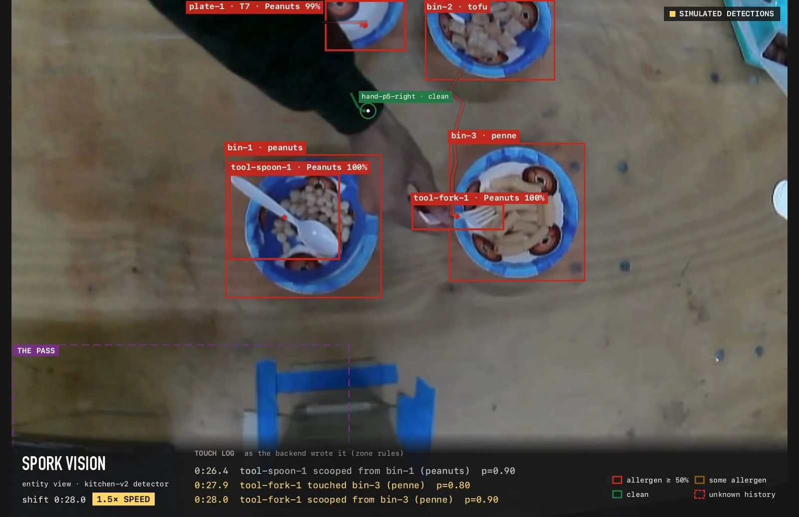</td>
</tr>
<tr>
<td><sub>The <code>/zones</code> screen. <code>slot-1</code> to <code>slot-5</code> hold the bins; the other zones are the wash, clean stack, plating spot and pass. Saving sends the layout to vision, which uses it from the next frame.</sub></td>
<td><sub>Tracked entities. The spoon and fork have both been in the peanuts. The touch log at the bottom lists each edge as it's written.</sub></td>
</tr>
</table>

## Architecture

Every message between folders is defined by a schema in [`contracts/`](contracts/README.md). SpacetimeDB holds the shared state, and each table has one writer.

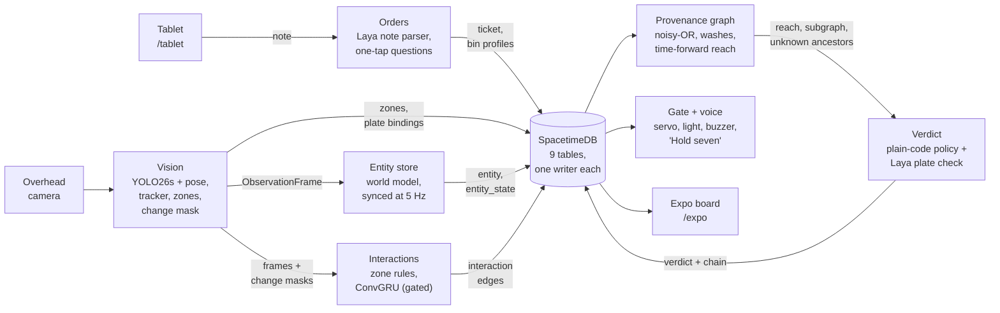

| Step | What it does | Tech | Folder |
|---|---|---|---|
| Orders | Note → forbidden allergens; unsure fields → questions; writes the ticket | Fine-tuned Laya, FastAPI, Cartesia Ink | [`kitchen/orders/`](kitchen/orders/) |
| Vision | Frames → detections → tracks → entities, zones, plate bindings, change masks | ONNX Runtime (CoreML on Mac), Hailo-8L bundle, ByteTrack-style tracker | [`kitchen/vision/`](kitchen/vision/) |
| Entities | In-memory record of every entity this shift, synced to the database at 5 Hz | Python | [`kitchen/entities/`](kitchen/entities/) |
| Interactions | Nearby pairs → features and motion clips → classified edges | Zone rules (live), ConvGRU (not yet adopted) | [`kitchen/interactions/`](kitchen/interactions/) |
| ConvGRU | Predicts contact and material moved from box masks and a change mask | PyTorch, ONNX | [`kitchen/lstm/`](kitchen/lstm/) |
| Graph | Noisy-OR propagation, washes, time-ordered paths, reachability, live risk for overlays | Python | [`kitchen/graph/`](kitchen/graph/) |
| Verdict | PASS or HOLD in plain code, with the contamination chain | Python, fine-tuned Laya | [`kitchen/verdict/`](kitchen/verdict/) |
| Gate and web | Gate state machine and voice; tablet, expo, layout, graph and video-summary screens | React, TypeScript, Vite | [`kitchen/gate/`](kitchen/gate/), [`web/`](web/) |
| Simulator | Simulated kitchens with known labels; 48,000 training clips for the ConvGRU | NumPy | [`kitchen/sim/`](kitchen/sim/) |
| Database | 9 tables, 8 reducers, and the Python `StateClient` | SpacetimeDB 2.13, Rust | [`database/`](database/) |

## Request flow

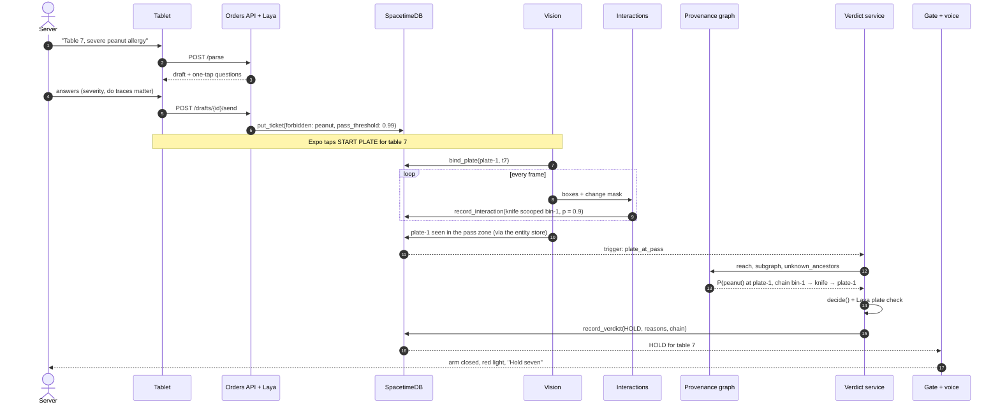

The verdict service also runs when a ticket is amended and when an edge arrives after a plate's verdict was made. Each run starts from the plate's full history.

## Components

### Orders

- The server types the note or speaks it (transcribed by Cartesia Ink and confirmed by the server).
- Laya returns each allergen with a severity, trace sensitivity and confidence, plus exceptions such as "coconut is fine".
- Fields below 0.85 confidence become questions. Allergens above 0.15 are never dropped.
- Sending with an open question returns `409 unanswered_questions`. If Laya is down, the API returns `503` and writes nothing.
- Tickets store forbidden allergens and a pass threshold from the strictest severity: 0.80 preference, 0.90 intolerance, 0.95 allergy, 0.99 anaphylactic.
- An amendment writes revision + 1. An allergen is removed only if a person answers "No" to it.

### Vision

- Detection: the partner's fine-tuned YOLO26s (`kitchen-v2`: fork, knife, spoon, bowl, hand) plus stock YOLOv8s-pose for wrists. On a Mac, ONNX Runtime with CoreML runs the frame loop in about 40 ms per 1280×720 frame (about 300 ms on CPU only). The same code is packaged as a Hailo-8L bundle with a parity check.
- Tracking: a ByteTrack-style tracker. A track lost for more than 1 s comes back as a new entity with unknown history.
- Identity: a bowl in `slot-4` is `bin-4`; any other bowl is a plate. Origin is `shift_start`, `clean_stack` or `unknown`.
- Change mask: one channel per frame showing what moved. The simulator uses the same function.
- API: `POST /plates/start`, `GET /stream.mjpg`, `GET /health`, `GET`/`PUT /zones`. If the detector fails, `/health` goes stale and the gate faults.

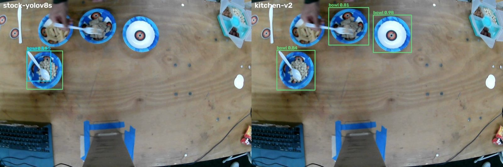
<sub>One frame from a real take. Stock YOLOv8s finds one bowl; `kitchen-v2` finds three of four (0.81–0.98). On four real takes, `kitchen-v2` found utensils in every frame of one take and almost none of the other three.</sub>

### Entities

Holds every entity for the shift (ID, kind, zone, box, first and last seen, origin) and syncs to the database at about 5 Hz. Entities are never deleted, and origin never changes. Only a tool, hand or plate seen at shift start or leaving a clean stack starts clean. Anything else carries every allergen until washed.

### Interactions

Each frame, hand–tool, tool–bin, tool–plate, hand–bin and hand–plate pairs within 5% of the frame width become candidate pairs. A tool or hand in the wash zone is paired with itself, since a wash is a self-loop edge.

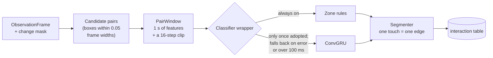

Zone rules (live):

| Action | Condition | Probability | Direction |
|---|---|---|---|
| `transfer.scoop` | Tool overlaps a bin in its slot for 300 ms | 0.90 | bin → tool |
| `transfer.contact` | Any pair overlaps by ≥ 0.1 for 200 ms | 0.80 | both |
| `clean.wash` | Tool or hand in the wash zone for 3 s, 3 s after its last transfer | 0.95 | self-loop |
| `unimportant` | Anything else | — | no edge |

The ConvGRU (called the ConvLSTM in the design docs) takes a 16-step clip covering about 1 s, with three 128×128 channels: box A's mask, box B's mask and the change mask. It never sees pixels, object classes or allergens, so it learns contact and movement rather than what the objects are. It outputs P(contact) and P(material moved), which map to `transfer.contact` and `transfer.scoop`.

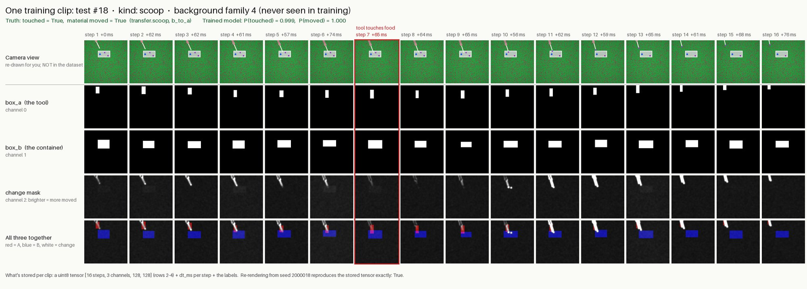
<sub>One simulated scoop, on a background the model never saw in training. The model reads rows 2–4; row 1 is for people. The tool touches the food at step 7. Truth: touched, material moved. Model: 0.999 and 1.000.</sub>

It was trained only on simulated clips, so zone rules stay in charge until it beats them on real labeled footage. Zone rules also take over whenever it errors or takes more than 100 ms.

### Provenance graph

- Transfer (noisy-OR): `P_dst(a) ← 1 − (1 − P_dst(a)) · (1 − k · p · P_src(a))`, with edge probability `p` and transfer efficiency `k`.
- Wash: `P(a) ← (1 − p) · P(a)`.
- Paths count only if their edges are in increasing time order. Ties sort by end time, then wash before transfer, then event ID.
- An entity with unknown history carries every allergen at probability 1 until washed.
- Reachability returns, for each plate, every allergen above zero and its strongest chain back to a bin.

Two of the golden test scenarios, with `k = 1`. Scenario 1 is `knife-carries-peanut-to-plate` (anaphylactic ticket, threshold 0.99). Scenario 2 is `wash-resets-knife` (allergy ticket, threshold 0.95).

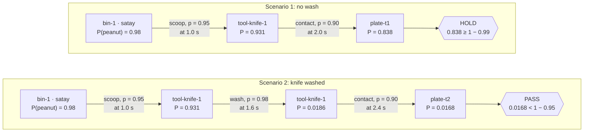

The washed knife passes an allergy ticket but would still hold an anaphylactic one, since 0.0168 ≥ 0.01.

A verdict takes about 90 ms on a 5,000-edge shift. `LiveRisk` reruns propagation at about 5 Hz to color the camera overlays; it isn't used for verdicts.

### Verdict

```
confidence = max(0, 1 − Σ p[a] for a in forbidden)   # 0 if any input is unhealthy
flagged(a) = p[a] ≥ 1 − pass_threshold               # from the graph, or from Laya
hold       = any flagged or confidence < pass_threshold or any error
```

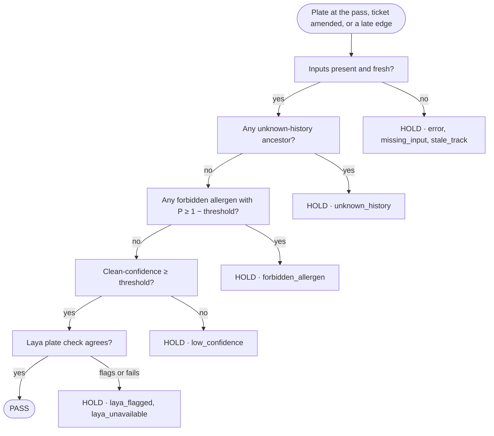

Every applicable reason is recorded. The same inputs produce byte-identical verdict JSON.

The Laya plate check reads the plate's time-ordered subgraph (up to 15 edges) and returns P(reached the plate) for each forbidden allergen. It can add a hold or fail into one. It can't remove a hold or cause a PASS.

### Gate and web app

The gate service polls the database a few times a second. It is closed by default and opens only for a PASS on the plate at the pass, for the ticket's current revision.

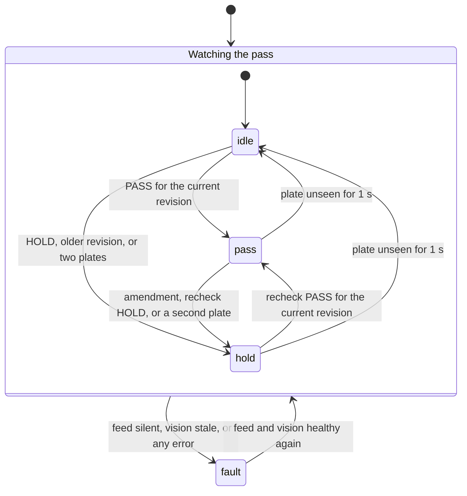

In `fault` the arm is closed, the light is red and the buzzer pulses. A plate hidden by a hand still counts as being at the pass for 5 s, so the gate can't open for one plate while another is out of view.

| Screen | Purpose |
|---|---|
| `/tablet` | Enter a ticket, answer questions, send, amend |
| `/expo` | Gate status, tickets, held plates with reasons and chains, live camera with risk-colored boxes |
| `/zones` | Draw and edit the kitchen layout |
| `/graph` | Force-directed view of the provenance graph |
| `/summary` | Upload a recorded video and see what touched what |

The web app makes no decisions. One tested function renders PASS, and only from `verdict.decision == "pass"`. If the state feed drops, every screen shows FEED LOST.

### Simulator

The simulator renders eight kinds of episode (scoop, deposit, wipe, touch, pass over, hover, motion nearby, approach and leave) as plain shapes on random backgrounds. Clips go through the same change-mask and clip-builder code as live frames, and labels come from the simulation. Hard negatives cover overlap without contact, nearby motion, lighting flicker, camera noise, box jitter, missed detections and uneven frame timing. No seed appears in two splits, and the test split uses backgrounds that training never sees.

### Database

SpacetimeDB 2.13 runs locally with a Rust module: 9 tables (`allergen`, `zone`, `ticket`, `bin_profile`, `entity`, `entity_state`, `plate_binding`, `interaction`, `verdict`) and 8 idempotent reducers. Python uses HTTP reducer calls and polls SQL every 0.2 s; each write polls only the tables it touched. That change cut a 26.5 s demo scene from 96.3 s of processing to about 20 s, and from 28,007 HTTP requests to about 9,300. Any timeout or bad response raises `StateUnavailable`.

## Safety rules

Tests for these rules are marked `safety`: 855 of about 1,600 Python tests.

| # | Rule | In the code |
|---|---|---|
| 1 | Fail closed | Missing input, error, timeout, stale track or unknown history → HOLD; silent feed → gate `fault` |
| 2 | Plain-code verdict | `decide()` is a pure function; models only supply inputs; Laya's plate check can only add holds |
| 3 | No unanswered questions | A ticket with an open question can't be sent (`409`) |
| 4 | Allergens, not contacts | Tickets store forbidden allergens; the graph decides which contacts matter |
| 5 | Time runs forward | Paths count only with edges in increasing time order |
| 6 | Blind classifier | Features and clips carry no allergen, class or pixel data; the schemas reject extra fields |
| 7 | Rules stay as the fallback | The ConvGRU replaces zone rules only after beating them on real held-out clips |
| 8 | Known-clean source | Only shift-start or clean-stack entities start clean; a re-acquired track gets a new ID and unknown history |
| 9 | Late changes recheck everything | An amendment re-runs the verdict on the full history; an older revision's PASS can't open the gate |

Other checks: Hypothesis property tests (for example, shortening a history never lowers reach, 20,000 examples), fault injection on every `StateClient` and `ProvenanceGraph` call, differential testing of the graph on 4,600 random kitchens, and 1,800 fuzzed kitchens with dropped tracks that lost no contamination paths.

## Models

| Model | Task | Training | Result |
|---|---|---|---|
| kitchen-v2 (fine-tuned YOLO26s) | Detect forks, knives, spoons, bowls, hands | 160 epochs at 960 px | mAP50 0.843, mAP50-95 0.769; bowls found in 99–100% of real frames, utensils much less often |
| YOLOv8s-pose (stock) | Wrist keypoints for hand boxes | COCO | Used as shipped |
| laya-v1 (fine-tuned Laya) | Ticket note → allergens, severity, traces, exceptions | 31,783 notes | 98.1% correct allergens on held-out notes (base: 73.2%) |
| laya-plate-v2 (fine-tuned Laya) | Final plate check | 1,700 generated kitchens, ~28 min on one A6000 | 98.4% on 200 held-out kitchens; no misses at the anaphylactic threshold; 7/7 golden verdicts |
| boxpooled-v2.4 (ConvGRU, 67k params) | P(contact), P(material moved) | 48,000 sim clips (40k/4k/4k), 37.5 min | 99.9% contact and 98.5% moved accuracy on held-out sim clips with unseen backgrounds; 47 ms median per clip on CPU; not yet tested on real clips |

<picture>
  <source media="(prefers-color-scheme: dark)" srcset="docs/images/charts/laya-fine-tuning-dark.svg">
  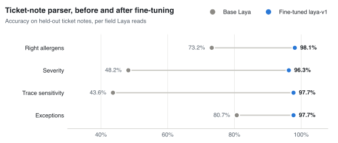
</picture>

Weights are on the GitHub releases, not in git (see [Getting the models](#getting-the-models)).

## Contracts and fakes

Folders depend on each other only through [`contracts/`](contracts/README.md), and every interface has a fake. This let six agent teams and the partner work in parallel without waiting on each other.

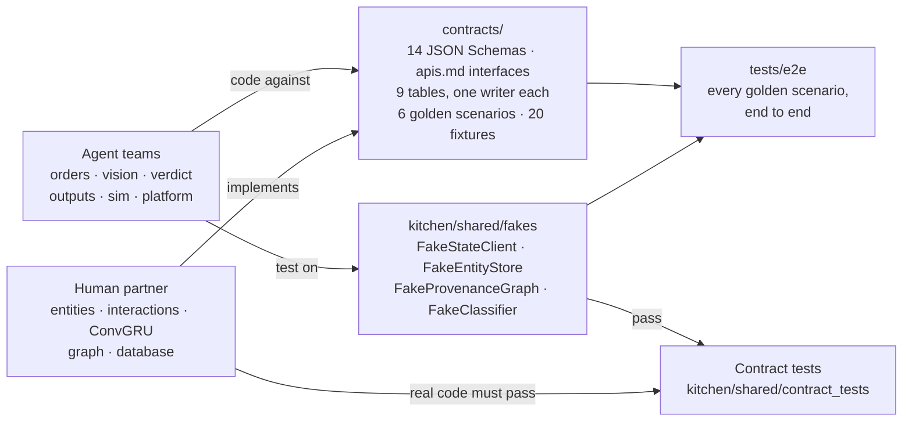

Records are plain dicts validated against the schemas. Logic takes a `Clock` instead of reading the wall clock, so runs replay byte for byte. CI rejects any non-`partner/` branch that touches a partner-owned folder.

## Development process

Two people and a set of Claude Code agents built Spork, organized by [`AGENTS.md`](AGENTS.md) and [`.claude/agents/`](.claude/agents/). The owner made product calls and merged agent PRs. The partner owned the entity store, interactions, ConvGRU, graph and database, and merged their own PRs. Agents built the rest.

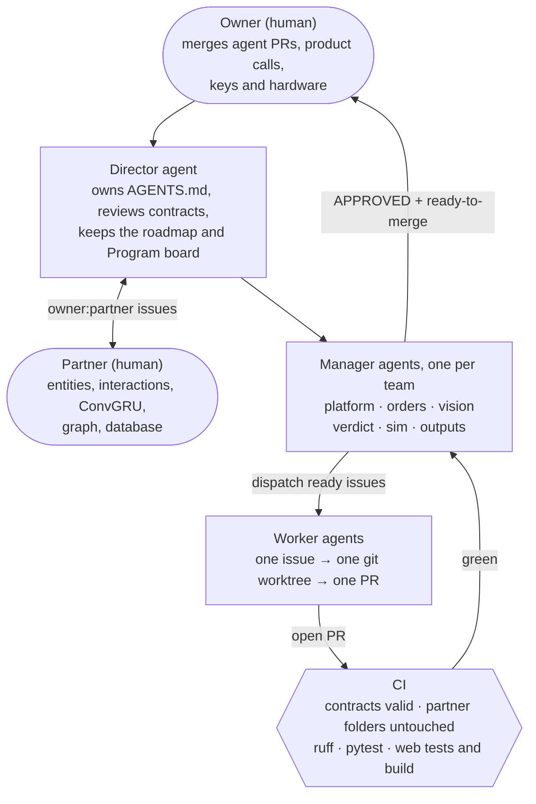

- Each issue has acceptance criteria with the command that proves them, and fits in about 400 changed lines.
- A Manager reviews each PR once against the diff and CI. Safety-critical PRs also need every error path to end in HOLD.
- Agents build against fakes and don't wait for the partner's code.

<picture>
  <source media="(prefers-color-scheme: dark)" srcset="docs/images/charts/build-pace-dark.svg">
  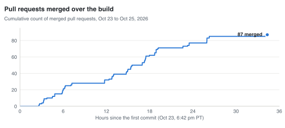
</picture>

<picture>
  <source media="(prefers-color-scheme: dark)" srcset="docs/images/charts/prs-by-team-dark.svg">
  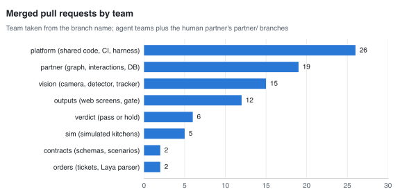
</picture>

| | |
|---|---|
| Build time | About 32 hours from first PR to last |
| Pull requests | 106 opened, 87 merged |
| Issues | 148 (110 closed), 5 milestones |
| Commits on `main` | 110 |
| Python | ~13,900 lines in `kitchen/` and ~12,800 lines of tests there; 2,400 in `tools/`; 2,000 in `tests/e2e/` |
| TypeScript | ~3,900 lines of app code, ~2,000 lines of tests |
| Rust | 546 lines |
| Tests | ~1,600 Python (855 `safety`), 115 web |
| Contracts | 14 schemas, 20 fixtures, 6 golden scenarios, 9 allergens |

## Repository layout

| Path | Contents | Owner |
|---|---|---|
| [`AGENTS.md`](AGENTS.md) | Rules, roles, workflow, teams, roadmap and open questions for agents | — |
| [`kitchen/`](kitchen/README.md) | All Python, one folder per pipeline step, each with its own README | agents + partner |
| `kitchen/entities/`, `kitchen/interactions/`, `kitchen/lstm/`, `kitchen/graph/`, [`database/`](database/) | Entity store, interactions, ConvGRU, graph, SpacetimeDB module | partner |
| [`web/`](web/README.md) | Tablet, expo, layout, graph and video-summary screens | agents (outputs) |
| [`contracts/`](contracts/README.md) | Schemas, interfaces, table spec, fixtures, golden scenarios | agents (platform), Director reviews |
| [`tests/e2e/`](tests/e2e/README.md) | Every golden scenario through every step's public interface | agents (platform) |
| [`tools/`](tools/) | Contract validator, local runner, demo check, video summary, real-clip test | agents (platform) |
| [`docs/decisions/`](docs/decisions/) | One page per hard-to-reverse decision | — |
| [`docs/demo-runbook.md`](docs/demo-runbook.md) | Starting, checking and rehearsing the live demo | — |

Agents start from [`AGENTS.md`](AGENTS.md); to run the org, start the Director with `claude --agent director` ([details](AGENTS.md#14-running-the-org-claude-code)). The partner opens PRs from `partner/<slug>` branches, and their code must pass the contract tests in `kitchen/shared/contract_tests/`.

## Running it

```bash
uv sync --all-extras
uv run python tools/validate_contracts.py
uv run pytest -m 'not hardware and not slow'
```

### The whole kitchen on one laptop

No camera and no partner database: `tools/run_local.py` serves the end-to-end harness's `Kitchen` (the Orders API, the verdict service and the gate loop on one shared `FakeStateClient`) on a live clock, replays a golden scenario's kitchen, and serves every table at `GET /state`.

```bash
uv run python tools/run_local.py knife-carries-peanut-to-plate
```

Notes are parsed by `FakeLayaParser` and plates checked by `FakeLayaCheck` unless `LAYA_MODEL_DIR` and `LAYA_PLATE_MODEL_DIR` point at the fine-tuned checkpoints (see `.env.example` and [Getting the models](#getting-the-models)). With them, add the `laya` package for the run; loading both takes about 15 s:

```bash
uv run --env-file .env --with laya==0.4.14 python tools/run_local.py knife-carries-peanut-to-plate
```

Then point the web app at it (see [Run it](web/README.md#run-it) in `web/README.md`) and open `/expo`. For the live camera, run the runner with `--live` and follow [`docs/demo-runbook.md`](docs/demo-runbook.md).

### Getting the models

The learned models aren't in git (nothing over 1 MB goes in git). They're zips on this repo's GitHub releases, about 1.9 GB in all. The repo is private, so `gh` must be logged in to an account that can see it.

| Release | Asset | Unzips to | What it is |
|---|---|---|---|
| [`laya-models-v1`](https://github.com/Shashank1775/calhacks-allergy/releases/tag/laya-models-v1) | `laya-v1.zip` | `data/models/laya-v1/` | Laya note parser (`LAYA_MODEL_DIR`) |
| | `laya-plate-v2.zip` | `data/models/laya-plate-v2/` | Laya plate check (`LAYA_PLATE_MODEL_DIR`) |
| | `laya_training.zip` | `data/laya_training/` | Laya training data |
| [`lstm-models-v2_4`](https://github.com/Shashank1775/calhacks-allergy/releases/tag/lstm-models-v2_4) | `boxpooled-v2_4.zip` | `data/models/lstm/boxpooled-v2_4/` | The shipped ConvGRU interaction classifier (`LSTM_MODEL_DIR`) |
| | `boxpooled-v1.zip` | `data/models/lstm/boxpooled-v1/` | Its first version (the default `LSTM_MODEL_DIR`) |
| [`vision-model-v2`](https://github.com/Shashank1775/calhacks-allergy/releases/tag/vision-model-v2) | `BEST_MODEL.zip` | `data/models/kitchen-v2/` (built below) | The laptop's detector: the partner's fine-tuned YOLO26s (fork, knife, spoon, bowl, hand), the default `VISION_BUNDLE_DIR` |
| [`visionModelV3`](https://github.com/Shashank1775/calhacks-allergy/releases/tag/visionModelV3) | `exp-4.pt` | `data/models/kitchen-v3/` (built below) | The partner's next fine-tune, same classes (`VISION_BUNDLE_DIR=data/models/kitchen-v3`) |
| [`vision-model-v1`](https://github.com/Shashank1775/calhacks-allergy/releases/tag/vision-model-v1) | `stock-yolov8s.zip` | `data/models/stock-yolov8s/` | The stock YOLOv8s bundle (ONNX) |
| | `stock-yolov8s-hailo8l.zip` | `data/models/stock-yolov8s-hailo8l/` | The Pi's Hailo-8L bundle |
| | `yolov8s-weights.zip` | `data/weights/` | Stock YOLOv8s and YOLOv8s-pose weights and their ONNX exports |

From the repo root:

```bash
# Laya: note parser and plate check (about 780 MB each), and the training data
gh release download laya-models-v1 -p laya-v1.zip -p laya-plate-v2.zip -D data/models
unzip -o data/models/laya-v1.zip -d data/models
unzip -o data/models/laya-plate-v2.zip -d data/models
gh release download laya-models-v1 -p laya_training.zip -D data
unzip -o data/laya_training.zip -d data

# The ConvGRU interaction classifier
gh release download lstm-models-v2_4 -p 'boxpooled-*.zip' -D data/models/lstm
unzip -o data/models/lstm/boxpooled-v2_4.zip -d data/models/lstm
unzip -o data/models/lstm/boxpooled-v1.zip -d data/models/lstm

# Vision: the stock bundle, the Pi's Hailo-8L bundle and the stock weights (pose.onnx comes from these)
gh release download vision-model-v1 -p stock-yolov8s.zip -p stock-yolov8s-hailo8l.zip -D data/models
unzip -o data/models/stock-yolov8s.zip -d data/models
unzip -o data/models/stock-yolov8s-hailo8l.zip -d data/models
gh release download vision-model-v1 -p yolov8s-weights.zip -D data
unzip -o data/yolov8s-weights.zip -d data

# Vision: the laptop's detector, exported to ONNX and bundled (--video only feeds the Hailo calibration frames)
gh release download vision-model-v2 -p BEST_MODEL.zip -D data/models
unzip -o data/models/BEST_MODEL.zip -d data/models/kitchen-v2/train
uvx --from ultralytics==8.4.188 --with onnx --with onnxslim --with onnxruntime \
    yolo export model=data/models/kitchen-v2/train/exp-3.pt format=onnx imgsz=640 opset=11 simplify=True
uv run python -m kitchen.vision.bundle --name kitchen-v2 --weights custom --class-names fork,knife,spoon,bowl,hand \
    --det-onnx data/models/kitchen-v2/train/exp-3.onnx --pose-onnx data/weights/yolov8s-pose.onnx --video data/recordings/<any>.mp4

# Vision: the partner's next fine-tune, the same way
gh release download visionModelV3 -p exp-4.pt -D data/models/kitchen-v3/train
uvx --from ultralytics==8.4.188 --with onnx --with onnxslim --with onnxruntime \
    yolo export model=data/models/kitchen-v3/train/exp-4.pt format=onnx imgsz=640 opset=11 simplify=True
uv run python -m kitchen.vision.bundle --name kitchen-v3 --weights custom --class-names fork,knife,spoon,bowl,hand \
    --det-onnx data/models/kitchen-v3/train/exp-4.onnx --pose-onnx data/weights/yolov8s-pose.onnx --video data/recordings/<any>.mp4
```

Each release's notes give every zip's size and sha256 (check one with `shasum -a 256 <zip>`), and each unzipped folder has a `data-manifest.json` with every file's size and sha256.

## Limitations

- The demo runs on a laptop with ONNX Runtime. The Raspberry Pi 5 + Hailo-8L path (bundle, setup script, parity check) is built but wasn't used for the demo.
- Zone rules classify live interactions. The ConvGRU is trained and wired in behind the fallback but not adopted, because the real-clip benchmark hasn't been run.
- The detector finds bowls reliably but misses utensils on most real takes. Demo frames with hand-filled boxes are tagged.
- The web app reads the local runner's `GET /state`, not SpacetimeDB's TypeScript bindings, which aren't generated yet. Per-table single-writer checks aren't enforced in the module yet.
- The full-shift simulator (`world.py`, `scenarios.py`) isn't built; the six golden scenarios are hand-written.
- The gate hardware (servo, light, buzzer) and Cartesia Sonic voice run as fakes that print to the terminal.
